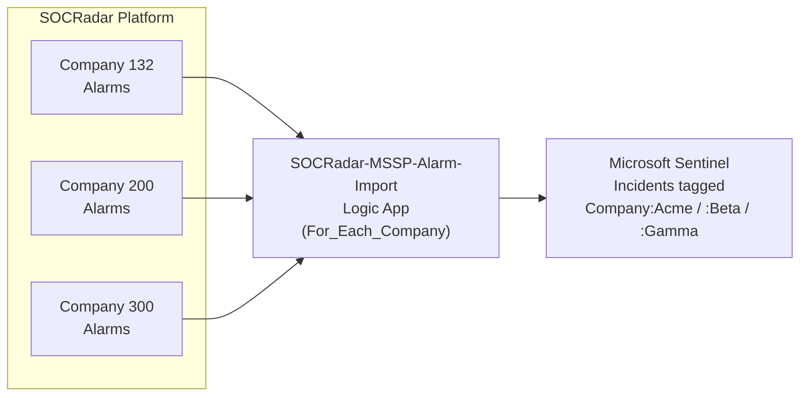
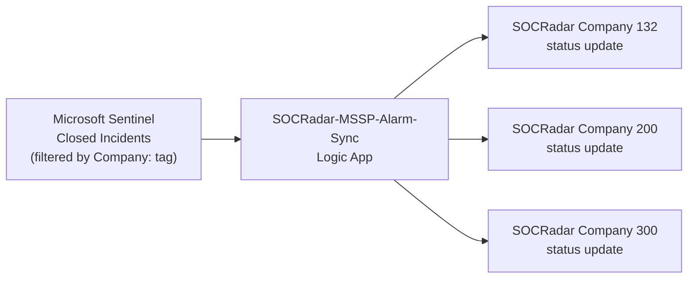

# SOCRadar MSSP Alarms for Microsoft Sentinel — **Standalone**

> This is the **Standalone** Deploy-to-Azure source. For the Microsoft Sentinel **Content Hub Solution** (Solution package + V3 Marketplace path), see [`../Solution/readme.md`](../Solution/readme.md).

Bidirectional integration for **MSSPs and holding companies** — one Microsoft Sentinel workspace imports alarms from **multiple SOCRadar Company IDs**. Microsoft Sentinel incidents are tagged per company, and closed incidents sync back to the matching SOCRadar account.

For **single-customer** deployments, use the standalone [`SOCRadar-Azure-Incidents`](https://github.com/orcunsami/SOCRadar-Azure-Incidents) repository instead.

## When to choose Standalone (this) vs Content Hub Solution

| Path | When to use | What you get |
|------|-------------|--------------|
| **Standalone (this)** | Customer wants one-click GitHub button install (`Deploy to Azure`), no Microsoft Sentinel Marketplace browse needed | Single ARM template that creates all resources end-to-end (Logic Apps + DCE + DCR + tables + workbook + role assignments) |
| **Content Hub Solution** ([`../Solution/`](../Solution/)) | Customer wants Microsoft Sentinel **Content Hub → Install → Manage** Marketplace path | Same resources, but installed as a Microsoft Sentinel Solution → 2 playbook templates surface under **Automation → Playbook templates** |

Both paths share source code (`Solution/Playbooks/*` is regenerated from `Seperate-Repo/Playbooks/*` via `dev/scripts/local/`).

## Architecture

### Multi-company Alarm Import

One Logic App polls SOCRadar **per company per cycle**. Incidents created in Microsoft Sentinel are prefixed `[<CompanyName>]` and tagged with `Company:<CompanyName>`.

### Bidirectional Sync

When a SOCRadar-tagged Microsoft Sentinel incident is closed, the integration parses the `[<CompanyName>]` prefix to map back to the right `CompanyId`, then updates the alarm on SOCRadar.

### Analytics

Alarms and audit events are written to MSSP-specific custom Log Analytics tables with a `company_name` column. The bundled workbook, hunting queries, and analytic rules all group / filter by company.

## How is this different from the single-customer integration?

| Surface | Single-customer `SOCRadar` | MSSP `SOCRadar MSSP` (this) |
|---------|---------------------------|----------------------------|
| Input parameter | `CompanyId` (single) | `CompanyIds` (CSV) + `CompanyNames` (CSV) |
| Logic App iteration | One company per run | `For_Each_Company` Foreach (concurrency 1) + per-company error isolation |
| Incident title | `<alarm_title>` | `[<CompanyName>] <alarm_title>` |
| Incident tag | SOCRadar + main_type + sub_type | + `Company:<CompanyName>` |
| Dedup key | `alarm_id` | composite `(company_id, alarm_id)` |
| LAW tables | `SOCRadar_Alarms_CL`, `SOCRadarAuditLog_CL` | `SOCRadar_MSSP_Alarms_CL`, `SOCRadar_MSSP_AuditLog_CL` (with `company_name`) |
| API key | Single-customer key | **MSSP-scoped key** — one key authorises every Company ID listed |

Both integrations share the **Option A** infrastructure pattern (DCE + custom tables + DCRs + role assignments embedded inside the Import playbook) and can co-exist in the same resource group — resource names are prefixed `SOCRadar-MSSP-`.

## Prerequisites

- Microsoft Sentinel workspace.
- **MSSP-scoped SOCRadar API key** — one key that grants access to every Company ID monitored. Configured by the SOCRadar account team.
- Comma-separated lists of SOCRadar `CompanyIds` and matching `CompanyNames` (same length, positionally matched).

## Parameters

### Required

| Parameter | Description |
|-----------|-------------|
| `WorkspaceName` | Microsoft Sentinel workspace name (not the GUID) |
| `WorkspaceLocation` | Workspace region (e.g. `northeurope`) |
| `SocradarApiKey` | MSSP-scoped SOCRadar API key |
| `CompanyIds` | Comma-separated SOCRadar Company IDs (e.g. `132,200,300`) |
| `CompanyNames` | Comma-separated human-readable names matching `CompanyIds` positionally (e.g. `Acme,Beta,Gamma`). Used in `[<CompanyName>]` title prefix and `Company:<CompanyName>` tag. |

If `CompanyIds` and `CompanyNames` have different lengths, the first Logic App run terminates with a descriptive `InvalidInput` error.

### Optional

| Parameter | Default | Description |
|-----------|---------|-------------|
| `WorkspaceResourceGroup` | deployment RG | Set if workspace is in a different RG |
| `SentinelRoleLevel` | `Responder` | `Responder` (least-privilege) or `Contributor` |
| `PollingIntervalMinutes` | `5` | How often to poll SOCRadar (1–60) |
| `InitialLookbackMinutes` | `600` | First-run lookback window (10 hours) |
| `ImportAllStatuses` | `false` | `true` imports RESOLVED / FALSE_POSITIVE / MITIGATED too |
| `EnableAuditLogging` | `true` | Writes per-company audit events to `SOCRadar_MSSP_AuditLog_CL` |
| `EnableAlarmsTable` | `true` | Stores full alarm JSON in `SOCRadar_MSSP_Alarms_CL` |
| `EnableWorkbook` | `true` | Deploys the SOCRadar MSSP Dashboard workbook |
| `TableRetentionDays` | `365` | Retention for custom tables (30–730) |

## What Gets Deployed

- **SOCRadar-MSSP-Alarm-Import** Logic App — multi-company import with embedded infrastructure (DCE + custom tables + DCRs + role assignments)
- **SOCRadar-MSSP-Alarm-Sync** Logic App — multi-company sync back to SOCRadar via the `Company:<name>` tag
- **SOCRadar_MSSP_Alarms_CL** custom table (optional)
- **SOCRadar_MSSP_AuditLog_CL** audit table (optional)
- **SOCRadar MSSP Dashboard** workbook (optional)
- Data Collection Endpoint + Rules for custom tables
- 5 hunting queries + 3 analytic rules (all group by `company_name`)

## Role Selection

Logic Apps authenticate to Microsoft Sentinel via **Azure Managed Identity**:

- **Responder** (default) — enough for create / update / close / classify.
- **Contributor** — only if you rely on automation rules that need elevated access.

No App Registration, no Microsoft Graph permissions, no federated identity credentials.

## Cross-Region / Cross-RG

- Different region → set `WorkspaceLocation`.
- Different resource group → set `WorkspaceResourceGroup`. Custom tables and workbook deploy into the workspace RG; Logic Apps deploy into the deployment RG.

## Per-company Error Isolation

Each company iteration runs inside a `Scope_Try_Company` block with a sibling `Scope_Catch_Company`. If SOCRadar's API returns 403 for one company (e.g. the MSSP key isn't scoped for it), the run logs an audit row with `Severity_s="ERROR"` for that company and proceeds with the next. One company's failure does not block the others.

## Post-Deployment

Logic Apps start polling **3 minutes after deployment** so role assignments have time to propagate. The `Recurrence` trigger uses `operationOptions: SingleInstance` to prevent overlapping runs when iterating large CSVs.

## End-to-End Test Status

Live E2E test on Azure (2026-05-15 NZST):

- **Standalone greenfield deploy** (CompanyIds=`132,200,300`, CompanyNames=`Acme,Beta,Gamma`) → `Succeeded` in 52s
- **Logic App Import run**: For_Each_Company iterated 3 companies, For_Each_Alarm processed 2 alarms (Gamma), Ingest_To_Custom_Table **2/2 Succeeded**
- **LAW `SOCRadar_MSSP_Alarms_CL`**: 2 rows ingested with `company_name=Gamma`
- **LAW `SOCRadar_MSSP_AuditLog_CL`**: per-company audit rows written (INFO + ERROR semantics confirmed)
- **Microsoft Sentinel Incidents**: 2 incidents created with `[MSSP-Gamma]` title prefix and `Company:Gamma` label
- **Idempotency**: re-trigger same run → 0 new incidents created (composite `(company_id, alarm_id)` dedup PROVEN)

See [`../to-Radargoger/TESLIM-MSSP-Incidents.md`](../to-Radargoger/TESLIM-MSSP-Incidents.md) for the full evidence table.

## Support

- **Public Documentation:** [One-Click Deployment Guide](https://github.com/Radargoger/azure-one-click-documentations/blob/main/azureincidents.md) (general — applies to both single-customer and MSSP)
- **Detailed Documentation (SOCRadar customers):** [Microsoft Azure Microsoft Sentinel Integration (Bi-Directional)](https://help.socradar.io/hc/en-us/articles/41316851769745-Microsoft-Azure-Sentinel-Integration-Bi-Directional)
- **Support email:** integration@socradar.io
