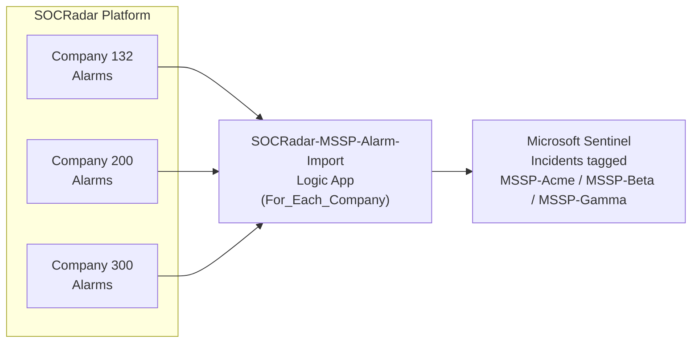
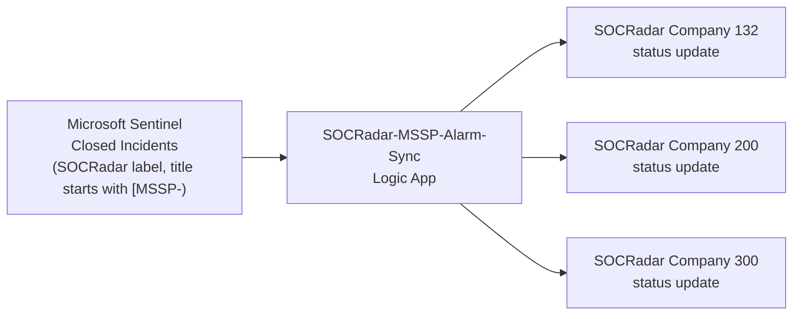

# SOCRadar MSSP Alarms for Microsoft Sentinel

Bidirectional integration for **MSSPs and holding companies** - one Microsoft Sentinel workspace imports alarms from **multiple SOCRadar Company IDs**. Microsoft Sentinel incidents are tagged per company, and closed incidents sync back to the matching SOCRadar account (`TruePositive` and `Undetermined` -> Resolved, `FalsePositive` -> False Positive, `BenignPositive` -> Mitigated).

[](https://portal.azure.com/#create/Microsoft.Template/uri/https%3A%2F%2Fraw.githubusercontent.com%2Forcunsami%2FSOCRadar-Azure-MSSP-Incidents%2Fmaster%2Fproduction%2Fazuredeploy.json)

For **single-customer** deployments, use the [`SOCRadar-Azure-Incidents`](https://github.com/orcunsami/SOCRadar-Azure-Incidents) repository instead.

## Architecture

### Multi-company Alarm Import

One Logic App polls SOCRadar **per company per cycle**. Incidents created in Microsoft Sentinel are titled `[MSSP-<CompanyName>] #<alarm_id> - <alarm_title>` and labelled `MSSP-<CompanyName>`.



### Bidirectional Sync

When a SOCRadar-tagged Microsoft Sentinel incident is closed, the integration parses the `[MSSP-<CompanyName>]` prefix to map back to the right `CompanyId`, then updates the alarm on SOCRadar.



### Analytics

Alarms and audit events are written to MSSP-specific custom Log Analytics tables with a `company_name` column. The bundled workbook, the 5 hunting queries and the 3 analytic rules all key on `company_name`, so a spike in one tenant neither masks nor triggers another.

## How is this different from the single-customer integration?

| Surface | Single-customer `SOCRadar` | MSSP `SOCRadar MSSP` (this) |
|---------|---------------------------|----------------------------|
| Input parameter | `CompanyId` (single) | `CompanyIds` (CSV) + `CompanyNames` (CSV) |
| Logic App iteration | One company per run | `For_Each_Company` Foreach (concurrency 1) + per-company error isolation |
| Incident title | `<alarm_title>` | `[MSSP-<CompanyName>] #<alarm_id> - <alarm_title>` |
| Incident tag | SOCRadar + main_type + sub_type | + `MSSP-<CompanyName>` (tag and label) |
| Dedup key | `alarm_id` | `(CompanyName, alarm_id)` parsed from the incident title |
| LAW tables | `SOCRadar_Alarms_CL`, `SOCRadarAuditLog_CL` | `SOCRadar_MSSP_Alarms_CL`, `SOCRadar_MSSP_AuditLog_CL` (with `company_name`) |
| API key | Single-customer key | **MSSP-scoped key** - one key authorises every Company ID listed |

Both integrations share the same infrastructure pattern (DCE + custom tables + DCRs + role assignments embedded inside the Import playbook) and can co-exist in the same resource group - MSSP resource names are prefixed `SOCRadar-MSSP-`.

## Prerequisites

- Microsoft Sentinel workspace.
- **MSSP-scoped SOCRadar API key** - one key that grants access to every Company ID monitored. Configured by the SOCRadar account team.
- Comma-separated lists of SOCRadar `CompanyIds` and matching `CompanyNames` (same length, positionally matched).

## Parameters

### Required

| Parameter | Description |
|-----------|-------------|
| `WorkspaceName` | Microsoft Sentinel workspace name (not the GUID) |
| `SOCRadarAPIKey` | MSSP-scoped SOCRadar API key |
| `CompanyIds` | Comma-separated SOCRadar Company IDs (e.g. `132,200,300`) |
| `CompanyNames` | Comma-separated human-readable names matching `CompanyIds` positionally (e.g. `Acme,Beta,Gamma`). Used in the `[MSSP-<CompanyName>]` title prefix and the `MSSP-<CompanyName>` tag. |

If `CompanyIds` and `CompanyNames` have different lengths, the first Logic App run terminates with a descriptive `InvalidInput` error.

### Optional

| Parameter | Default | Description |
|-----------|---------|-------------|
| `WorkspaceLocation` | deployment RG region | Workspace region (e.g. `northeurope`); set it when the workspace is in another region |
| `location` | deployment RG region | Region of the Logic Apps and their API connection |
| `WorkspaceResourceGroup` | deployment RG | Set if workspace is in a different RG |
| `DeployNewWorkspace` | `true` | Create `WorkspaceName` when it does not exist yet; an existing workspace under that name is left untouched (pricing tier, retention, daily cap). Set `false` when the workspace must already exist, so a misspelled name fails before anything is created. Ignored when `WorkspaceResourceGroup` is not the deployment RG. |
| `SentinelRoleLevel` | `Responder` | `Responder` (least-privilege) or `Contributor` |
| `PollingIntervalMinutes` | `5` | How often to poll SOCRadar (1-60) |
| `InitialLookbackMinutes` | `600` | First-run lookback window (10 hours) |
| `ImportAllStatuses` | `false` | `true` imports RESOLVED / FALSE_POSITIVE / MITIGATED too |
| `EnableAuditLogging` | `true` | Writes per-company audit events to `SOCRadar_MSSP_AuditLog_CL` |
| `EnableAlarmsTable` | `true` | Stores full alarm JSON in `SOCRadar_MSSP_Alarms_CL` |
| `EnableWorkbook` | `true` | Deploys the SOCRadar MSSP Dashboard workbook (needs `EnableAlarmsTable` and a workspace in the deployment RG) |
| `SyncSeverity` | `false` | Push the Microsoft Sentinel incident severity back to SOCRadar on close. Off by default: Microsoft Sentinel has no Critical severity, so a CRITICAL alarm imports as High and writing that back would downgrade the alarm on SOCRadar |
| `TableRetentionDays` | `365` | Retention for custom tables (30-730) |

## A wrong workspace name fails before anything is created

With `DeployNewWorkspace=false` the deployment resolves the workspace in a
`precheck-workspace-exists` step that every other resource waits on. A name that does not
exist leaves the resource group empty and the only failed operation is that one step.

This used to half-install. Depending on the Workspace resource was not enough, because ARM
counts a resource whose `condition` is false as a satisfied dependency -- so the Microsoft
Sentinel API connection, the Data Collection Endpoint, the workbook and **both** Logic Apps
were created, and only then did the deployment fail. The Import Logic App is enabled and
billable in that state. If you are looking at a resource group left that way by an earlier
attempt, redeploying over it with the correct name reconciles it; until then, disable the
Logic Apps or delete the resource group.

With `DeployNewWorkspace` at its default `true` a typo does not fail: it creates a second,
empty workspace under the misspelled name. The pre-check is skipped in that mode, because the
workspace may not exist yet. Set it `false` when you point at an existing workspace and want a
wrong name to stop the deployment.

### Redeploy to fix a failed deployment -- do not delete the Logic Apps first

Redeploying over the same resource group is the way to fix a failed or partial deployment.
Deleting the Logic Apps first is not: the role assignments are named after the workspace and
the playbook, not after the identity they grant, so a deleted Logic App leaves its assignment
behind with a principal that no longer exists. The next deployment computes the same
assignment name for a new identity and Azure refuses it with
`RoleAssignmentUpdateNotPermitted`. Delete the orphaned assignments -- the ones with no
`principalName` -- and redeploy.

## Existing installations

Deployments made before `DeployNewWorkspace` existed stated a pricing tier on the workspace
resource, and a template overwrites every field it states. If the target workspace was on a
**commitment tier**, that deployment reset it to `PerGB2018` (pay-as-you-go).

Check the current tier:

```bash
az monitor log-analytics workspace show -g <resource-group> -n <workspace> \
  --query "{sku:sku.name, lastSkuUpdate:sku.lastSkuUpdate}" -o json
```

If `lastSkuUpdate` lines up with when you first deployed this integration and the tier isn't
the one you picked, reset your commitment tier from **Log Analytics workspaces > Usage and
estimated costs > Pricing tier**. The current template states no workspace-level settings at
all, so redeploying or upgrading an existing install -- with `DeployNewWorkspace` at its default
`true` -- cannot change its pricing tier, retention or daily cap.

## What Gets Deployed

- **SOCRadar-MSSP-Alarm-Import** Logic App - multi-company import with embedded infrastructure (DCE + custom tables + DCRs + role assignments)
- **SOCRadar-MSSP-Alarm-Sync** Logic App - multi-company sync back to SOCRadar via the `[MSSP-<name>]` title prefix
- **SOCRadar_MSSP_Alarms_CL** custom table (optional)
- **SOCRadar_MSSP_AuditLog_CL** audit table (optional)
- **SOCRadar MSSP Dashboard** workbook (optional)
- Data Collection Endpoint + Rules for custom tables
- 5 hunting queries + 3 analytic rules (all keyed on `company_name`)

## Role Selection

Logic Apps authenticate to Microsoft Sentinel via **Azure Managed Identity**:

- **Responder** (default) - enough for create / update / close / classify. The Import Logic App also gets **Log Analytics Reader** on the workspace.
- **Contributor** - only if you rely on automation rules that need elevated access.

No App Registration, no Microsoft Graph permissions, no federated identity credentials.

## Cross-Region / Cross-RG

- Different region -> set `WorkspaceLocation`.
- Different resource group -> set `WorkspaceResourceGroup`. The Logic Apps, their role
  assignments and the Microsoft Sentinel API connection deploy into the deployment RG, and
  incidents are created in the external workspace as normal.

  The custom tables are **not** available in this mode, and neither is the workbook that
  reads them. `SOCRadar_MSSP_Alarms_CL`, `SOCRadar_MSSP_AuditLog_CL`, their data collection
  rules and the endpoint are all workspace-RG resources this deployment does not reach, so
  `EnableAuditLogging` and `EnableAlarmsTable` are forced off when the workspace is external.
  Deploy into the workspace's own resource group if you want them.

  The earlier wording here said the tables and workbook "deploy into the workspace RG". They
  never did, and until 8 Sep 2026 a cross-RG deployment did not even complete: the Logic Apps
  asked for the endpoint's address and it had not been created.

Cross-RG needs Microsoft Sentinel already onboarded on that workspace. This template creates
the Microsoft Sentinel solution and its onboarding state only in the deployment resource
group, so a `precheck-external-workspace` step reads the external workspace's onboarding
state and stops the deployment when Microsoft Sentinel is not there. Without it the
deployment went green and imported nothing.

## Per-company Error Isolation

Each company iteration runs inside a `Scope_Try_Company` block with a sibling `Scope_Catch_Company`. If SOCRadar's API returns 403 for one company (e.g. the MSSP key isn't scoped for it), the run logs a `CompanyImportFailed` audit row (`Severity="High"`) for that company and proceeds with the next. One company's failure does not block the others.

## Post-Deployment

Logic Apps start polling **3 minutes after deployment** so role assignments have time to propagate. The `Recurrence` trigger uses `operationOptions: SingleInstance` to prevent overlapping runs when iterating large CSVs.

## Support

- **Detailed Documentation (SOCRadar customers):** [Microsoft Azure Sentinel Integration (Bi-Directional)](https://help.socradar.io/hc/en-us/articles/41316851769745-Microsoft-Azure-Sentinel-Integration-Bi-Directional)
- **Support email:** integration@socradar.io
